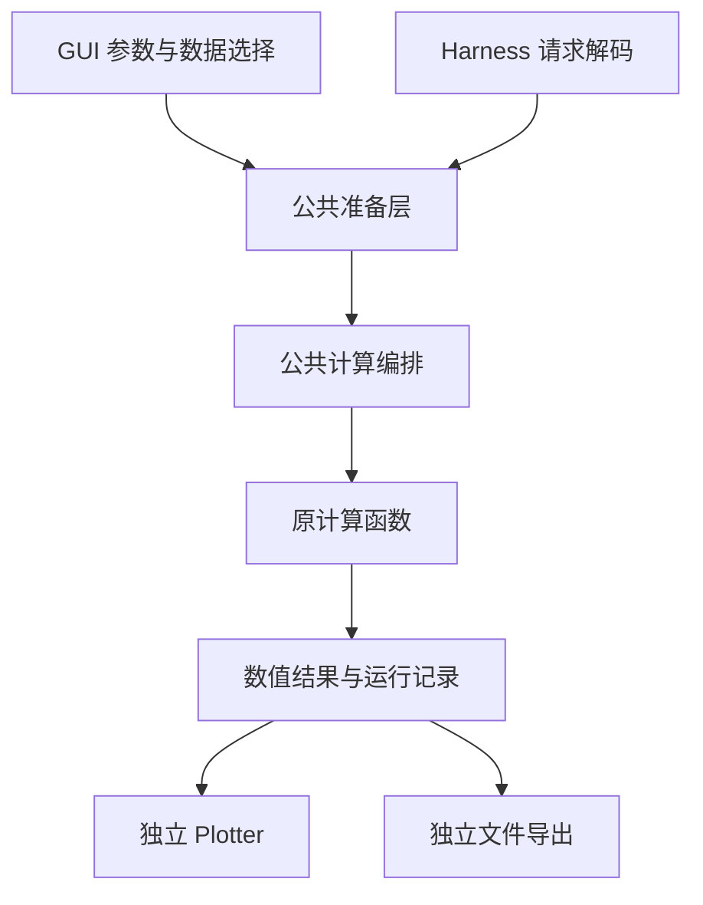

# GUIDE 迁移后的耦合评估与公共 API 建议

核对日期：2026-11-18。本文评估源码结构，不声称完成 MATLAB、GUI 或数值等价性测试。上游源码没有修改。

**结论：3.X 的解耦有实质改善，但改善集中在界面构建方式与部分计算入口。去掉 GUIDE 本身没有把 GUI 工作流变成可复用计算 API。可以保留已有独立计算函数，在 `guicode` 旁增加公共 MATLAB API；主要工作应放在提取参数准备、计算编排、结果组织及绘图边界，而非重新实现算法。**

## 对照版本与证据口径

| 快照 | 提交 | 意义 |
|---|---|---|
| GUIDE 旧版 | [`b52ea9f`](https://github.com/mingsongli/acycle/commit/b52ea9f510f3be00bde9a0238b9898a1e2315b74) | 用户指定的迁移前基线，2026-02-15 |
| 2 月迁移阶段 | [`681c1dc`](https://github.com/mingsongli/acycle/commit/681c1dc742cace22f515c5508b7b962692811739) | 2026-02-24；主要 GUI 已改为代码构建，仍有备份残留 |
| 3.0 发布 | [`083c949`](https://github.com/mingsongli/acycle/commit/083c949e5635fefb6a2227273c49329a0891147a) | 2026-07-25 |
| 当前 3.1.1 | [`dcba427`](https://github.com/mingsongli/acycle/commit/dcba4279168745b563e0535b954297023dd62fc7) | 本次核对时的 master，2026-08-14 |

采用四个快照，是为了区分最初的界面迁移、随后新增功能，以及后期明确进行的计算核心抽取。版本之间不是一次仅涉及界面的实验，不能把所有差异都归因于移除 GUIDE，也不能据此宣称 2.X 与 3.X 数值等价。代码能证明变更内容及时间；本次没有独立核实具体由哪个模型完成。

统计由 [compare_guide_coupling.py](tools/compare_guide_coupling.py) 产生，完整结果在 [comparison.json](coupling/comparison.json)。四份生产源码快照共解析 1,124 个文件实例、535 个不同源 blob，解析失败为 0；排除路径中名为 `test`/`tests` 的目录，保留生产树中的备份文件。按 MISS_HIT AST 识别调用，D 指数与旧注释编码仅在分析缓冲区适配。原始行数包括注释与空行。

## 哪些改善是真的，哪些仍然存在

| 指标 | GUIDE 旧版 | 2 月迁移阶段 | 3.0 | 当前 3.1.1 |
|---|---:|---:|---:|---:|
| `guicode` 下 `.fig` | 32 | 1 | 0 | 0 |
| 全仓库 `.fig` | 33 | 2 | 1 | 1 |
| `guicode` 中引用 `gui_mainfcn` 的文件 | 32 | 2 | 1 | 1 |
| `guicode` 中 MATLAB 文件 | 41 | 40 | 39 | 43 |
| `seriesanalysis/acycle*.m` | 0 | 0 | 0 | 18 |

当前剩余 `.fig` 属于第三方 Undatable；`guicode` 中仍引用 `gui_mainfcn` 的文件只有遗留 `spectrumBKUP.m`。2 月阶段的两项为 `ACBKUP.m`、`spectrumBKUP.m`。不能因此把当前全部 Acycle/第三方代码称为完全 GUIDE-free。

**界面载体的耦合明显降低。** 布局和回调注册从二进制 `.fig` 转为可审查的 MATLAB 文本，部分窗口改成类或局部状态，较容易独立构造、比较修改、定位事件接线。这对于维护 GUI 和定位 Harness 的接入点有真实价值。

**最初的迁移主要保留了原工作流。** 从旧基线到 `681c1dc`，`code/seriesanalysis` 和 `code/corrcoef` 没有任何文件变化。2 月的 `AC.m` 启动器仍明确采用“代码构建界面并复用旧回调”，通过 `guidata` 和 `AC_OpeningFcn` 继续传递状态。当前 [AC.m:83](https://github.com/mingsongli/acycle/blob/dcba4279168745b563e0535b954297023dd62fc7/code/guicode/AC.m#L83) 仍保留这一路径；新的 [ac_gui_dispatch.m](https://github.com/mingsongli/acycle/blob/dcba4279168745b563e0535b954297023dd62fc7/code/guicode/ac_gui_dispatch.m) 解决回调句柄生命周期问题，并不是科学计算 API。

**后期确实又进行了一轮实质解耦。** 2026-08-11 的 [`885c742 — Add reusable desktop analysis cores`](https://github.com/mingsongli/acycle/commit/885c742de1d582c4b56afc6aab083f412f8bd373) 新增了一批显式输入输出的 `acycle*` 核心，并让部分 GUI 委托给它们。当前 Gaussian/Taner 滤波就是现有 GUI 功能抽取成功的例子。新增的 bispectral 与 cvCOCO 也提供了较清晰的计算/绘图分离，但它们作为新功能，不能单独证明所有旧功能已经解耦。

文件变短也不足以证明解耦：

| 文件 | GUIDE 旧版行数 | 当前行数 | 结构判断 |
|---|---:|---:|---|
| `AC.m` | 10,066 | 11,470 | 主窗口状态、数据准备和大量菜单工作流仍集中 |
| `spectrum.m` | 3,967 | 1,972 | 缩短明显，计算/模型选择/绘图/输出仍在同一闭包内 |
| `DYNOS.m` | 1,980 | 1,093 | 已有独立单次 worker，但完整 MC 工作流仍绑定 GUI |
| `ft.m` | 912 | 801 | 两种带通走新核心，其余 IIR 分支仍嵌在 App 私有方法 |
| `eCOCOGUI.m` | 2,571 | 3,339 | 新计算核心较好，数据策略、默认值、编排和科研输出仍留在 GUI |

这些行数是结构线索，不是耦合评分。类属性替代 `handles`、新增功能和 `.fig` 布局转成文本都会改变统计。完整调用标记与位置见 [file_indicators.csv](coupling/file_indicators.csv) 和 [selected_call_evidence.csv](coupling/selected_call_evidence.csv)。

## Harness 的实际障碍：五条调用链

### 1. 滤波：核心可复用，但 GUI 的输入准备也是行为的一部分

[ft.m:100](https://github.com/mingsongli/acycle/blob/dcba4279168745b563e0535b954297023dd62fc7/code/guicode/ft.m#L100) 的私有 `prepareInputSeries` 会清除非有限行、排序、合并重复坐标、检查非均匀采样、必要时插值，并移除均值。[acycleBandpassFilter.m:1](https://github.com/mingsongli/acycle/blob/dcba4279168745b563e0535b954297023dd62fc7/code/seriesanalysis/acycleBandpassFilter.m#L1) 则要求已规则采样的数据，不负责排序或插值。

因此，Harness 直接调用同一个滤波核心，只能保证核心相同，不能保证从同一原始文件出发的整个 GUI 工作流相同。GUI 和核心还各有中心化处理，首轮迁移应保留现有顺序并测量结果，不能顺手把看似重复的处理删掉。

[ft.m:475](https://github.com/mingsongli/acycle/blob/dcba4279168745b563e0535b954297023dd62fc7/code/guicode/ft.m#L475) 和第 496 行已委托 Gaussian/Taner 到新核心；第 517–538 行的 Cheby1/Ellip/Butter 带通，以及第 542–628 行的高通/低通/带阻仍直接设计滤波器并调用 `filtfilt`。`acycleBandpassFilter` 目前只有 Gaussian 和 Taner 两种方法，不能把其接口当作 GUI 全滤波功能的覆盖。

### 2. Spectrum：计算可以保留，但工作流入口尚未独立

[spectrum.m:390](https://github.com/mingsongli/acycle/blob/dcba4279168745b563e0535b954297023dd62fc7/code/guicode/spectrum.m#L390) 的 `runSpectrum` 同时读取控件、去均值、推导采样和 NFFT、请求 robust AR(1) 参数、计算谱、建立图窗、生成置信线及保存文件。其嵌套 `computeSpectrum` 在第 1569 行，`selectedNw` 和 `chooseNfft` 在第 1850/1858 行；作为普通公共 MATLAB 函数，它们尚不能独立调用。

这里应提取的是科学工作流及其 Helper，继续使用现有 `pmtm`、`plomb`、`redconfML`、`redconfchi2` 等实现。尤其要把显示范围与计算范围分清：第 499–506 行的 Lomb 分支会以 `max(physicalNyquist, fmax)` 确定计算上限。当前名为显示设置的参数可能影响实际计算，不能按变量名字机械归入 Plotter。

### 3. DYNOT：一个值得重点验证的公共 API 试点

[dynotIterationWorker.m](https://github.com/mingsongli/acycle/blob/dcba4279168745b563e0535b954297023dd62fc7/code/guicode/dynotIterationWorker.m) 虽然位于 `guicode`，本身已有显式数据、参数和结果：插值、去趋势、补边、调用 `pdan`，再插值到输出网格。目录归属不等于运行职责；这个文件可以先保留原路径与原字节。

但是 [DYNOS.m:541](https://github.com/mingsongli/acycle/blob/dcba4279168745b563e0535b954297023dd62fc7/code/guicode/DYNOS.m#L541) 的 `runDynot` 仍混合随机参数生成、模态进度条、MC 编排、归一化、分位数、绘图、写 base workspace 和文件输出。第 884 行的并行编排也仍接受 GUI 状态与进度窗口句柄。

可以在保持 worker、`pdan`、`zeropad2` 等独立计算代码不变的前提下，抽出一次完整 DYNOT 运行的编排。随机参数生成的次序须逐句保留：第 552–558 行特意无条件抽取两个替换随机数，以维持历史随机流。仅设置相同 seed 并不能自动保证改写后的结果一致。

不要用新的 `acyclePowerDecomposition` 替换 DYNOT 的 `pdan`；后者[明确保留旧 bin 映射和 bin-sum 比值](https://github.com/mingsongli/acycle/blob/dcba4279168745b563e0535b954297023dd62fc7/code/seriesanalysis/pdan.m#L1)，前者是不同的严格边界 PSD 积分约定。

### 4. `plot=0` 是可用接缝，但不能当作无副作用保证

保留计算函数内部的旧绘图分支没有原则性问题。只要绘图关闭后所有必需数值结果仍能返回，且调用路径的其他副作用已有明确处理，API 可以直接复用该函数，不必为追求文件纯粹而拆它。

当前有两个具体反例提醒我们逐路径核对：

- [spectralswafdr.m:95](https://github.com/mingsongli/acycle/blob/dcba4279168745b563e0535b954297023dd62fc7/code/package/swa/spectralswafdr.m#L95) 和第 499 行在 `plotn` 判断之外写固定文件。现有 [spectrum.m:1016](https://github.com/mingsongli/acycle/blob/dcba4279168745b563e0535b954297023dd62fc7/code/guicode/spectrum.m#L1016) 已通过临时工作目录、`onCleanup` 和 `plotn=0` 隔离它，这是保留原核心的现成范例。`cd` 是进程级状态，因此该隔离适合串行调用或独立 MATLAB 进程，不能宣称支持同进程并发重入。
- [ecoco.m:350](https://github.com/mingsongli/acycle/blob/dcba4279168745b563e0535b954297023dd62fc7/code/corrcoef/ecoco.m#L350) 的旧 Fast/Accurate 兼容分支，在没有 `ProgressFcn` 时仍创建 waitbar，与 `plotn` 无关。提供非空进度回调可绕过这项 UI，但仍应显式提供单位等参数并检查依赖。现代 Adaptive/Blocked/Interleaved 分支在第 152–304 行单独返回，**不能把旧分支的 waitbar 问题归给全部现代 eCOCO**。

新 `corrcoefslices_rankNew` 已区分 `plotn`、`showProgress` 与 `ProgressFcn`。这类已有控制项应优先利用；一个总的“无图模式”开关不能替代逐方法的运行契约。

### 5. 新功能提供了可借鉴的边界，但默认值仍要共享

[bispectralAnalyze](https://github.com/mingsongli/acycle/blob/dcba4279168745b563e0535b954297023dd62fc7/code/package/bispectral/bispectralAnalyze.m) 返回数值结构，`bispectralPlot`/`bispectralSave` 消费结果；[cvcoco](https://github.com/mingsongli/acycle/blob/dcba4279168745b563e0535b954297023dd62fc7/code/corrcoef/cvcoco.m) 与 `plotcvcoco` 也具有类似分工。这种结构已经证明公共 MATLAB API 与科研绘图分离是可行的，不需要从零发明计算框架。

但 [eCOCOGUI.m:558](https://github.com/mingsongli/acycle/blob/dcba4279168745b563e0535b954297023dd62fc7/code/guicode/eCOCOGUI.m#L558) 之后仍负责原始/插值数据的选择、NFFT、窗口、补边和模式参数。Blocked/Interleaved 要求先划分再各自插值；不能新增一个所有方法共用的“先插值清理”Helper，否则会改变统计问题，甚至产生数据泄漏。共享的是明确的准备接口，各方法保留自身策略。

## 推荐的公共层：与 GUI 平行，对两端提供相同科学行为

建议新增类似 `code/+acapi/` 的 MATLAB package。以下名称是设计示意，本轮尚未实现这些接口。



```matlab
plan   = acapi.prepare("spectrum", data, parameters, context);
result = acapi.run(plan, runtime);
figs   = acapi.plot(result, plotOptions);
files  = acapi.export(result, exportOptions);
```

每个方法由明确注册的处理器实现；这个总入口不是任意 `feval` 或 GUI callback 执行器。也可以为常用方法提供具名薄包装。公共层处理 MATLAB 数组/结构，JSON、MCP、文件上传仍由 Harness 负责。

| 部分 | 归属内容 | 边界 |
|---|---|---|
| GUI adapter | 读取控件、文件选择、展示错误与交互选择 | 将 `handles`/App 属性转成显式数据；不向公共层传整个 App |
| Prepare / Helper | 数据策略、单位、默认参数、有效窗口/NFFT、方法合法性 | 输出实际采用的参数与处理记录；不同方法可以有不同准备规则 |
| Run | 调用顺序、MC/批处理编排、结果打包、进度/取消边界 | 原独立核函数优先字节不改；新增层不重写算法 |
| Plotter | 已有结果的科研图样、轴范围/配色/标注 | 能复用现成 Plotter 就直接复用；画图不重新拟合噪声、重跑 MC 或重抽样 |
| Export | TXT/MAT/表格、参数记录、图片导出 | 输出位置显式指定；不依赖主窗口目录或 base workspace |
| Runtime | seed、进度回调、取消、任务工作目录、资源限制 | 与科学参数区分；不要求 graphics handle；不能由进度显示改变随机流 |

结果结构至少应携带：主数值结果、重画图所需的诊断数组、实际生效参数、数据处理记录、方法/源码版本、seed 或随机状态约定、警告与完成状态。计算结果中不以 figure 或 UI 对象作为唯一的数据容器；Plotter 返回的图形句柄则是另一个接口的合法输出。

尤其需要区分三组容易混淆的约定：

1. **GUI 兼容准备与严格核心输入。** 明确声明是否复现当前 GUI 的清理/插值/中心化流程；不要悄悄换成新的“更合理”流程。默认值也应有版本依据。
2. **科学默认值与 Harness 资源预算。** 现有 Harness 某些入口有样本数、`nsim` 上限，这些是运行预算，不应无条件成为 GUI 的科学算法限制。超预算要显式报告，不能静默减少模拟次数。
3. **科学计算范围与显示范围。** 两者在旧 GUI 中可能共用参数。迁移时先记录旧映射，再把解析后的数值范围写入 plan；事后只改配色、标签等展示项不应重算。

现有 Harness 的 `acycle_native` 可继续作为低层 MATLAB 传输入口，但目录中的 337 个文件可定位并不等于 337 个科学工作流已完成产品化。已有 `acycle_batch`、`acycle_coco`、`acycle_swa` 也已经实现部分显式参数、上下文隔离和输出组织；应复用这些经验与已验证片段。最终需要让其科学准备/编排逐步委托公共层，避免 GUI 与 Harness 长期各维护一套默认值。来源基线：`_Codex:acycle-harness-master-interfaces@ecbf81a367425dd83d5400986dad87cc099057c8`，本次仅查阅，未迁移或修改该分支。

## 最小改动能做到什么，哪里必须承认边界

| 情况 | 推荐处理 | 原独立计算文件是否需改 |
|---|---|---|
| 已有显式输入/完整结果的核心 | 公共层直接调用，统一准备与元数据 | 通常不需要；先做哈希冻结 |
| `plotn=0` 后仍有固定文件等副作用 | 方法专属适配器管理目录/清理；必要时独立进程 | 经逐路径验证后可以不改 |
| 计算编排/Helper 嵌入 GUI 私有或嵌套函数 | 把现有语句机械提取成普通函数，GUI 改调用点 | 独立核心不改；GUI 和新增编排会改 |
| 数值中间结果只存在局部变量或图形状态 | 优先提取外层编排；确实无法获得时增加兼容的诊断输出 | 不能预先承诺全部文件零改动；单列例外 |
| 必须点选/拖拽的工作流 | 显式输入所选控制点/标定值，或标记仍需交互 | 不能靠跳过 `uiwait` 等待来声称等价 |

**想让 GUI 和 Harness 真正共享行为，需要逐功能修改少量 GUI 调用点。** 如果原 GUI 完全不动，只复制其 Helper/Plotter 到 API，新 API 可以暂时工作，但会出现两套逻辑漂移。合适的过渡是：先冻结 GUI 参考行为 → 提取一个模块 → 对照通过 → GUI 和 Harness 都改用该模块；不必重写整个主窗口。

独立核心按源码 SHA-256 冻结；GUI 中的计算块记录原文件/函数/行段/提交与提取后的差异。允许修改的是输入输出连接、错误/进度适配和副作用边界。不要同时“优化”随机数顺序、向量化循环、更换谱估计器、改变滤波参数或统一不同科学定义。

## 实施顺序与验收

1. **用 Gaussian/Taner 滤波建立第一条完整纵向路径。** 提取 `ft.prepareInputSeries` 的 GUI 兼容策略，保留 `acycleBandpassFilter`，让新结果可由 GUI 与 Harness 共用。这个试点可检验“准备 + 计算 + 科研绘图”，而不只检验传参。
2. **用 DYNOT 检验较难的编排。** 保留 `dynotIterationWorker`、`pdan`、`zeropad2`；从 `DYNOS.m` 分离参数生成、MC 编排、统计摘要与 Plotter。对照随机参数矩阵、每次 realization、最终分位数和串并行结果。
3. **逐步接入 spectrum、SWA、COCO/eCOCO。** 复用当前独立核心、现成 Plotter 和 Harness 隔离逻辑，把方法特有的数据准备和计算范围变成显式契约。IIR 各滤波分支单独列入，不混同 Gaussian/Taner 的现成覆盖。
4. **最后处理交互依赖和遗留路径。** Undatable、旧 GUI 兼容、未发布依赖与静态未达文件继续单独维护；不因为移除 GUIDE 或增加公共层而自动删除。

每个模块至少核验：相同原始输入与 GUI 设置下的 prepared data、解析后参数、核心实际调用参数、结果数组、图中实际数据，以及固定 seed 的随机路径。确定性流程优先要求相同结果；若只可接受数值容差，必须解释误差来源，不能用宽容差掩盖行为变化。图形验收以曲线/图层的数据与科学标注为主，截图仅辅助检查布局。

同时检查同一 MATLAB 进程重复调用后的 `pwd/path/rng`、图窗与 base workspace 状态，检查无图运行是否仍弹出交互窗口，以及不同任务的固定输出文件是否冲突。取消能力要记录实际边界：只在步骤间取消、合作式取消或进程终止，不把三者混为一谈。需要图像导出的运行仍可能需要 MATLAB 图形服务，不能与纯数值无界面执行混作同一能力。

历史测试可从上轮 [release_cleanup.json](reports/release_cleanup.json) 指向的清理前提交恢复，先审查契约再选择；本轮没有恢复或执行 MATLAB 测试。

## 新方法的维护边界：以贝叶斯滤波调谐为例

2026-11-18 补充。现有结构的主要维护风险是科学行为没有单一、完整的代码归属：参数默认值和预处理在 GUI，数值计算可能分散在新旧实现，结果组织和科研绘图又留在回调。新增方法如果继续沿用这种接入方式，方法作者、GUI 维护者和 Harness 维护者会被迫分别维护一部分科学定义。

建议以一个可独立运行、带测试和示例的“方法模块”为交付单位。可以将公开入口放在 `+bayestune` MATLAB namespace 下；内部现有数值函数先通过薄适配器复用，不要求一次性改名或拆散。MATLAB 原生支持 `+` 目录组织带命名空间的函数，见 [MathWorks 文档](https://www.mathworks.com/help/matlab/matlab_oop/namespaces.html)。下面仅为接口提案，尚未实现：

```matlab
problem = bayestune.prepare(data, modelConfig);
result  = bayestune.run(problem, runConfig);
figures = bayestune.plot(result, plotConfig);
```

| 所有者／部分 | 负责内容 | 修改时应影响的范围 |
|---|---|---|
| 方法作者：科学定义与计算 | 先验、似然、滤波、参比、年龄模型、数据准备规则、科学默认值 | 同一个方法模块；GUI 和 Harness 自动调用更新后的实现 |
| 方法作者：公开输入输出 | 数据和参数结构、明确单位、检查与有效参数、样本／诊断／运行记录 | 有契约变化时显式升级接口或科学模型版本 |
| GUI 维护者：界面适配 | 读取控件、选择数据／文件、展示结果、把进度与取消回调接到窗口 | GUI 的薄适配层；不复制似然、先验或滤波规则 |
| Harness 维护者：协议适配 | JSON／文件与 MATLAB 数据互转、任务预算、调用与结果取回 | Harness 适配层；不维护另一套科学默认值 |
| Plotter | 从既有结果绘制科研图、显示诊断 | 只改展示时无需重跑采样 |

**共享准备逻辑必须按方法定义，不能成为统一强制插值／清理器。** 对贝叶斯滤波调谐，原始非均匀深度坐标、控制点误差、hiatus、参比数据和滤波设定都可能属于模型。GUI 不能为了符合其他 Acycle 算法的输入要求，先自动插值、去趋势或删点；需要做的处理由该方法的准备入口决定并记录。

`modelConfig` 应覆盖影响科学含义的设置；`runConfig` 承担采样预算、随机流和可选进度／取消等执行设置。二者都需要记录，资源预算不能静默改变模型或减少模拟次数。进度回调不依赖特定窗口，计算模块本身不要求 App／handles；不能为显示进度而改变随机数流。

`result` 至少应包含后验样本或明确的保存位置、年龄／沉积速率摘要、采样诊断、实际参数、数据处理记录、方法／源码版本及随机流记录。函数返回值是结果的依据，图形和 base workspace 不承担唯一的数据保存职责。

这样，修改滤波器、先验或采样器主要修改方法模块；修改按钮布局主要修改 GUI。若新增科学参数确实需要新控件，GUI 仍需改显示与映射，但参数默认值、验证和含义不在 GUI 重新定义。新增返回字段应尽量兼容已有消费者；改变单位、先验或似然含义则不能伪装成普通界面升级。

维护需要把代码、文档、最小示例和回归测试一起版本化。对于此类随机推断，可把确定性的滤波／似然部件与固定种子的轻量采样检查分开；实质模型变化再运行相应合成恢复与统计诊断。不要求跨 MATLAB 版本的随机链逐样本完全一致，但应明确支持环境与数值／统计容差。MATLAB 支持 [function-based tests](https://www.mathworks.com/help/matlab/matlab_prog/function-based-unit-tests.html) 和 [runtests](https://www.mathworks.com/help/matlab/ref/runtests.html)，无需先改为庞大类体系。

可执行的渐进顺序是：

1. **新增方法先遵守模块边界。** 贝叶斯滤波调谐可以直接接入公共入口，不必等待所有旧 GUI 重构。
2. **旧功能逐项接入。** 对每个功能／模式冻结当前桌面行为，把 GUI 私有的科学准备与步骤组织提取到方法模块，随后让 GUI 和 Harness 共用它。
3. **同义入口委托同一实现，不同科学定义保留明确名称。** 例如旧 DYNOT 的 `pdan` 与精确积分 PDA 应明确区分；不要用一个隐蔽 GUI 条件决定不同定义。
4. **最后再删除真正失去用途的代码。** 核查外部脚本兼容、参考案例和测试后再废弃入口；一批只做结构迁移，另一批再做科学算法修正。

对新方法，GUI 不应成为方法的必需运行环境；对于已有独立函数中可关闭的 Plotter，可以先保留。优先稳定公开调用、科学规则与维护责任，比立即统一所有函数的内部形态更有价值。

## 复现本次源码比较

```bash
python audit/tools/compare_guide_coupling.py
python audit/tools/verify_audit.py
```

前者只通过 Git 读取四个固定快照，生成该目录下的 JSON/CSV；不会 checkout 历史版本或改上游文件。后者验证原审查的 412 个源码哈希与 15 份报告。本报告的证据足以支持结构评估和最小改动方案；API 实现、MATLAB 行为对照、无图运行和科学数值等价仍是实施阶段的验证事项。
