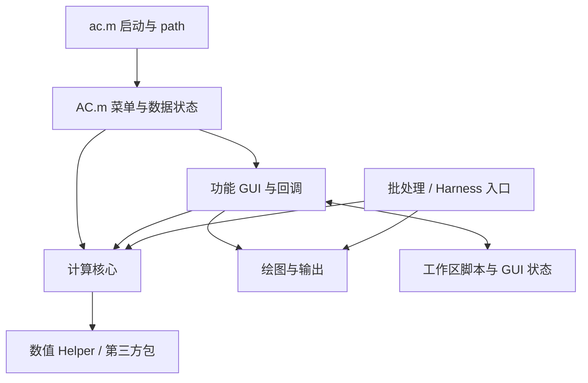

# Acycle 分支、调用关系及迁移清单

核对日期：2026-11-17。源码仓库：[mingsongli/acycle](https://github.com/mingsongli/acycle)。所有代码判断固定于 `dcba4279168745b563e0535b954297023dd62fc7`；本报告不是 MATLAB 运行或数值等价性验证。

## 1. 分支比较

| 分支 | HEAD | 提交日期（UTC+8） | 相对 master | 文件树 |
|---|---|---|---|---|
| master | `dcba42791687` | 2026-08-14 18:37:10 | 基线 | `089f6e76b485` |
| dev-codex | `4d62d54cc328` | 2026-08-14 18:35:29 | 领先 0、落后 1 | `089f6e76b485` |

GitHub 分支列表和完整 Git refs 均只列出这两个分支。**二者逐文件完全相同**。master 最后一项是 `Merge dev-codex into master`，其第二父提交就是 dev-codex HEAD。没有待合并的 dev-codex 独有实现；迁移基线采用 master 即可。不要把 merge commit 相对第一父提交的 diff 当作 master 与 dev-codex 的差异。

紧邻合并前的 `4d62d54` 发布整理，相对 `aee22a76a6261c95fdf3f6c9f8c97853270d0188` 删除了 **36 个测试／验证相关文件和 6 个 .bak 备份**，另改动 `.gitignore` 和 `ac.m`。36 个文件含 31 个 MATLAB 文件、4 个 Python 文件和 1 个 JSON schema。测试缺失是发布整理的结果，不代表这些功能没有测试历史。[恢复索引](reports/release_cleanup.json) 逐个记录了历史路径和可恢复提交；不要为了找测试而切换到 dev-codex，因为它也已移除这些文件。`ac.m` 还显式把 `code/test` 排除出生产 MATLAB path，以避免同名测试覆盖函数。

## 2. 清单的范围与读法

| 对象 | 数量 | 含义 |
|---|---:|---|
| 已跟踪文件 | 412 | 包括资源、数据、文档和原生二进制 |
| MATLAB 文件 | 337 | 287 个函数文件、16 个类文件、34 个脚本 |
| 函数／局部函数／嵌套函数／类方法声明 | 2,499 | 不能把每一项都当作独立对外 API |
| 桌面入口保守可达文件 | 242 | 从 `ac.m` 出发；包含运行时署名帮助文档 |
| 第一批计算 API 入口 | 19 | 18 个 `acycle*` 文件和 `bispectralAnalyze` |
| 上述 API 的保守依赖文件 | 29 | 仅 MATLAB 文件，不含 MathWorks toolbox 等环境依赖 |
| 桌面与 API 之外额外保留的可选入口及依赖 | 18 | 兼容入口、批处理、验证程序等 |
| 未进入上述三个入口集合的 MATLAB 文件 | 76 | 待分类／历史实现／独立工具，**不是可删除文件数** |
| 活跃文件内未接入桌面闭包的函数块 | 58 | 其中 38 个空函数体；可能存在外部动态调用 |
| 主菜单实例 | 128 | 117 项带回调，含隐藏菜单，不等于 117 个算法 |

桌面与 API 两个集合并集是 243 个文件；再加可选入口依赖是 261 个文件。`optional_roots` 单独计算的依赖集有 77 个文件，其中大部分与桌面/API 重叠，不能直接把 242、29、77 相加。19 个 API 是本次人工选择的第一批入口，不是 Acycle 的全部科学功能。

[migration_inventory.csv](reports/migration_inventory.csv) 覆盖全部 412 个路径，含源文件 SHA-256、分类、迁移建议、来向文件、可能副作用及判断依据；[manifest.json](reports/manifest.json) 是同一清单的机器可读形式。[symbols.csv](reports/symbols.csv) 保存声明作用域及行号；[edges.csv](reports/edges.csv) 保存具体调用位置和证据类型；[block_candidates.csv](reports/block_candidates.csv) 单列当前活跃文件里的悬置候选块。

## 3. 当前调用结构

这张图概括责任边界；精确逐文件关系见 [file_edges.csv](reports/file_edges.csv)。目前不能仅靠目录名称划分层次：`code/misc` 同时存放数值函数、绘图、GUI 辅助和依赖调用方变量的脚本；`code/seriesanalysis` 同时包含新核心、兼容包装和历史实现。

已经具备良好边界的例子是 `bispectralAnalyze → bispectralPreprocess / bispectralEstimate / bispectralSignificance`，绘图及保存由 `bispectralPlot / bispectralSave` 承担。`acycleBandpassFilter`、`acycleCoherencePhase`、`acycleDynamicFilter`、EMD、移动统计等也已具有显式输入输出，适合先保留原路径并接薄适配层。

仍需分阶段处理的区域是 `AC.m`（11,470 行）、`spectrum.m`、`eCOCOGUI.m`、`DYNOS.m`，以及它们对绘图、语言字典、进度／取消、文件选择和 `handles` 的依赖。`DYNOS.m:338,618–626` 仍向 base workspace 写结果，不能只包住主函数就认定为可并发批处理。[动态／工作区调用清单](reports/unresolved_dynamic.csv) 记录 132 个尚不能静态充分解析的现场，包含 eval、feval、assignin 等。

## 4. 已确认接线或遗留问题

下表中的“未接线”指当前自建 GUI 没有注册该入口，不排除用户通过 `AC('callback',...)` 或独立脚本显式调用。

| 对象 | 证据 | 迁移处理 |
|---|---|---|
| `spectrumBKUP.m` | 文件首函数仍叫 `spectrum`，依赖旧 GUIDE；当前 `AC.m:3780` 调用正式 `spectrum.m`。源码树没有旧 `spectrum.fig` | 归档候选，排除默认运行 path；不作为完整科学功能移植 |
| `SWA_refreshplot_CL_GUI.m`、`update_spectral_x_period_mtm.m` | 当前已跟踪可执行调用来自 `spectrumBKUP.m` | 与旧 GUI 一起处理，先保留历史 |
| `AC.m:421–430` 隐藏 Utilities 菜单 | 拼出的名字是 `menu_utilities_Callback`；实际只有 `menu_menu_utilities_Callback`（8133 行），且为空 | 明确的悬空绑定。本次记录，未顺便改变用户界面 |
| `menu_memd_Callback`，10607 行 | 函数体为空，无当前菜单注册 | 占位代码，不计作待迁移算法 |
| `menu_lyapunov_Callback`，11046 行 | 无当前菜单注册；11211、11355 行调用缺失的 `lyapunov_timeseries`；`.gitignore:9` 排除其目录 | 标记“缺算法依赖”，不能声称 Harness 已覆盖 |
| `menu_rhov2_Callback`，10614–11010 行 | 未接线的旧路径；正常 `menu_rho_Callback` 已使用 `acycleEvolutionaryRho1`，同时仍保留部分传统模拟路径 | 暂不迁移此重复 GUI 分支；不得未经对照删除底层函数 |
| `menu_dynot_v2_Callback`，11015 行 | 未接线；正常 `menu_dynos_Callback:3977` 已启动同一个 DYNOS | 暂不重复封装第二个启动器 |
| 旧自动更新链 | `ac_check_opendate → ac_check_update → ACUpdate` 无当前启动链引用；现行 `menu_findupdates_Callback:2962` 打开下载页 | 不纳入科学计算迁移范围 |
| `AC_OutputFcn`、多项 `*_CreateFcn` 及空容器回调 | 旧 GUIDE 生命周期遗留；当前由 `AC_buildCodeUI` 建控件 | 从 GUI 接线维护清单中分离；保留外部兼容调用说明 |

另有 `coherence_update → cohac`、`update_recplot → recplot` 等旧实现链，与新 GUI 的实现分离。它们是“优先对比后归档”的候选，不能仅凭功能名字相近认定结果等价。未人工判定的文件仍保持 `unreached_candidate / review_no_delete`，而不自动升级成“废弃”。

完整主菜单记录见 [menus.csv](reports/menus.csv)。目前发现的缺失回调仅上述隐藏 Utilities 一项；这不是 GUI 全部控件或运行时行为的验证结论。

## 5. 应保留的无菜单入口，以及必须区分的数值约定

**`acyclePowerDecomposition` 是特别有价值的反例。** 它是已抽取的可复用核心，但当前桌面依赖图没有使用它；`pda.m` 作为兼容入口委托给它。仍在桌面/DYNOT 路径中的 `pdan.m:1–14` 明确保留传统频率 bin 映射与 bin-sum power ratio，而新核心采用严格边界 PSD 积分。两者应作为不同约定保留，不能借“去重”改掉历史结果。

以下六个文件在首部明确声明兼容入口或别名，虽然没有当前桌面调用，仍须保留：`cvcoco2.m`、`cvcoco9.m`、`dynamic_filter.m`、`pda.m`、`gaussfilter.m`、`tanerhilbertML.m`。外部用户保存的脚本不在仓库内，静态图不会看到它们。

八个论文／批处理／输出入口（含五个 `run*`、重导出、校验和独立绘图）及三个 bispectral 验证入口已单列为可选保留。它们更适合将来迁移到 `examples`、`validation` 或独立批处理层；不应为追求简洁而删除。`cocoPublicationPrepareData` 等支持函数随该可选集合保留。

较旧 COCO/eCOCO 函数组如 `corrcoefsig`、`cyclecorr*`、`ecocos`、`ecocotrack*` 仍可构成独立调用链。缺少现行 GUI 来向只能说明它们不在当前桌面路径，无法证明所有旧论文脚本都已不再使用；本次保持待核对状态。

## 6. 资源与平台依赖

75 个非 MATLAB 文件也进入迁移清单。天文解、放射性碳校准表、语言表、图标和 Undatable 私有资源应按所属模块保留。不能只复制 `.m` 文件，也不能因字符串搜索不到文件名就删掉动态选择的数据表。

Undatable 唯一剩余的 `.fig` 中提取了 14 个回调，并已链接到对应函数；[fig_callbacks.json](reports/fig_callbacks.json) 保留证据。`nakeinterp1` 提供 Linux、Intel macOS、Windows 的 MEX，`udsummary` 还有 `interp1qr` 回退路径；[native_dependencies.csv](reports/native_dependencies.csv) 记录平台相关依赖。没有执行或验证任何 MEX。

`ac_pwd.txt`、`ac_lang.txt`、`ac_opendate.txt`、`ac_datenow.txt` 被单列为可变 GUI 状态种子。后续 Harness 应在每个任务内管理状态与输出位置，避免多个任务共享这些写入；本次固定源码快照中的内容保持原样。`.gitignore` 还提及未发布的 timeOpt、lyapunov、bigbang 目录，其缺失内容不计入此次可迁移源码集合。

## 7. 最小改动迁移顺序

1. **固定版本、保留原算法与路径。** 采用当前 master pin。此阶段不删除 76 个待复核文件，也不移动全部 337 个文件。把源码快照与 Harness 适配层分别管理。
2. **先复核 19 个现成计算入口。** 29 个文件的依赖范围较小；把数据、参数、随机种子、进度／取消和结果元数据契约写清，显式区分 `pdan` 与新 PDA。已有 native 接口目录不能替代数值回归。
3. **按功能拆 GUI，而不是按目录搬家。** 优先 spectral、COCO/eCOCO、DYNOT：计算结果由 core 返回，绘图只消费结果，Helper 处理验证/文件/路径，GUI 只收集参数和呈现。复用 bispectral 的既有拆分方式；不为得到新目录而改数值公式。
4. **恢复有针对性的历史测试。** 从清理前提交择取与当前目标相关的测试，在独立验证路径运行。旧测试可能含过期契约，必须先审查；本次没有恢复或运行它们。
5. **最后处理遗留代码。** 先归档明确旧 GUI 和空占位，再比较历史函数契约；兼容别名保留薄包装。每次删除都需要额外的外部调用和运行证据，不能由本清单自动触发。

因此，第一批接口整理的工作量可控，已有计算核心能明显降低改动量；完整拆分旧 GUI 的工作量仍较大。源码行数或“无来向文件数”不能直接换算成重构工作量，主要成本是锁定每条科学计算路径的结果约定和回归证据。

## 8. 复核方法与限制

分析器使用 MISS_HIT AST 识别函数作用域、嵌套函数、类方法、脚本、命令式调用和句柄；区分局部函数与同名文件，处理 `private` 的所属模块。已复核的动态构造（隐藏菜单）独立记录在 [decisions.json](decisions.json)。字面量 callback、`.fig` 回调和类方法保守边都有单独的 `kind`，不能把它们都解释为实际执行。

为兼容解析器，4 个 SWA 文件的 D 指数记法仅在分析缓冲区变为 E 指数，3 个旧源码文件采用 Latin-1 解码，CRLF 统一成 LF；源码和其哈希完全不变。因此“337 个文件进入 AST 清单”不是“337 个文件通过 MATLAB 语法检查”。`summary.json` 逐项列明适配处理。

局限包括动态 `eval/feval`、运行时对象类型、回调注入、调用方工作区、条件分支、外部用户脚本和真实 MATLAB path 顺序。类入口保守连向其方法；图中存在一些只在特定条件下才执行的边。源码中的绘图/IO 标记也是线索，不是无副作用证明。清单不涉及数学正确性或 GUI 可用性的运行结论。

本次验证审计器的作用域、变量遮蔽、脚本、句柄、字面量、私有函数等行为，并检查固定输入重生成的一致性。MATLAB、科学数值等价、GUI、MEX 与 GitHub Actions 均未运行；具体审计器检查记录见 [validation.json](reports/validation.json)。
