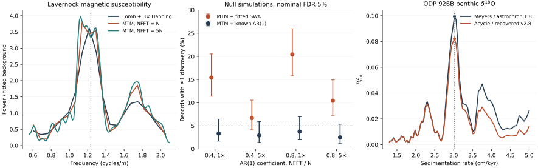

# Acycle 的 SWA/FDR、MTM/ML96 和 TimeOpt

审计对象为移除 GUIDE 前的最后一个公开提交 `b52ea9f` 与上游 master `dcba427`。另取发行标签 v2.8，核对真实的历史发行行为。MATLAB 对照使用 R2024b，TimeOpt 的参照使用 astrochron 1.8 与 R 4.5.0。两个发布案例分别来自 Lavernock 磁化率和 ODP 926B 底栖有孔虫氧同位素。脚本直接调用上游数值函数，输入在交给不同实现前统一。本次改动限于审计代码、数据分析和结果记录。

## SWA/FDR 有两条路径

独立 SWA 窗口调用 `specswafdr`，内部完成线性去趋势、两端余弦锥化、Lomb–Scargle 周期图和三次 Hanning 谱平滑，随后在对数功率上估计 SWA 背景，以 8 自由度计算尾概率并进行多重检验。这条路径能利用不等间距的观测坐标。Weedon 说明他在 2023 年向 Acycle 提供了 Fortran 代码。GUIDE 基线和 master 的该 MATLAB 翻译文件逐字节相同，两版都在此函数内部拟合背景。[Weedon 等，2019](https://doi.org/10.1017/S0016756818000808) · [Weedon 的说明](https://www.cyclostratigraphy.org/fileadmin/user_upload/Microsite_Cyclostratigraphy/lectures/Weedon/Weedon_Confidence-levels-for-power-spectra-_-Notes-notes.pdf) · [独立窗口](https://github.com/mingsongli/acycle/blob/dcba4279168745b563e0535b954297023dd62fc7/code/guicode/SWAgui.m#L139) · [数值实现](https://github.com/mingsongli/acycle/blob/dcba4279168745b563e0535b954297023dd62fc7/code/package/swa/specswafdr.m#L395)

主频谱窗口勾选 SWA 时调用 Li 的 `spectralswafdr(...,'mtm',...)`。它在等间距序列上用 `pmtm` 估计功率，再调用外部 `specswa`，按名义自由度 `2*K` 将功率/背景比转为尾概率。默认自适应 MTM 的权重可随频率改变。代码对包含直流分量的完整单边输出排序，以频率格点数作为检验数，用前 `floor(NW)` 项调和和修正临界值。在 `NW=2` 时这个因子是 1.5。补零会增加参与排序的频点，也会改变以频点数定义的 SWA 窗口在物理频率上的宽度。收窄 GUI 的显示范围只筛选已计算的结果。ML96 和 SWA 可以显示在同一分析流程里，各自使用自己的背景估计。[主频谱窗口](https://github.com/mingsongli/acycle/blob/dcba4279168745b563e0535b954297023dd62fc7/code/guicode/spectrum.m#L748) · [Li 的实现](https://github.com/mingsongli/acycle/blob/dcba4279168745b563e0535b954297023dd62fc7/code/package/swa/spectralswafdr.m#L121) · [MathWorks 的 MTM 定义](https://www.mathworks.com/help/signal/ref/pmtm.html)

master 修改了外部 `specswa` 的窗口中心插值、候选窗口打分、尾端二次拟合及最终平滑的停止规则。独立窗口保留内嵌代码。v2.8 到 GUIDE 基线还有一次单独变化，两个 SWA 程序把最后反复平滑的次数上限从 100000 改为 500。因此复现历史图件应固定具体提交及实际使用的入口。[旧背景算法](https://github.com/mingsongli/acycle/blob/b52ea9f510f3be00bde9a0238b9898a1e2315b74/code/package/swa/specswa.m) · [master 背景算法](https://github.com/mingsongli/acycle/blob/dcba4279168745b563e0535b954297023dd62fc7/code/package/swa/specswa.m)

### Lavernock 的峰和显著性

Weedon (2020) 图 11 报告 0–13.17 m 层段的约 0.81 m 峰超过 5% FDR。按同一层段从 PANGAEA 的磁化率列取出 439 个有效值，实际首末坐标为 0.03、13.17 m，按层位递增排列。预先规定在 0.74–0.88 m 区间取功率最高的局部峰。Lomb 路径使用原观测，MTM 使用等间距数据并去均值。[论文和图 11](https://doi.org/10.21701/bolgeomin.131.2.001) · [原始观测](https://doi.org/10.1594/PANGAEA.896872) · [案例定义](https://github.com/CinnabarCHU/Hypercinnabar/blob/d6b27b34597637e75fb8a1d4fe40874cf0bc1bcb/catalog/tasks.json)

| 实现 | NFFT | 全谱频点 | 峰波长 m | 峰功率 / SWA | 全谱有 5% FDR 发现 |
|---|---:|---:|---:|---:|---|
| 独立 Lomb，v2.8 | 原生频率格 | 218 | 0.82125 | 3.8721 | 否 |
| 独立 Lomb，GUIDE / master | 原生频率格 | 218 | 0.82125 | 3.6200 | 否 |
| v2.8 的 MTM | N | 220 | 0.87800 | 4.6099 | 是，所列峰也超过阈值 |
| GUIDE 的 MTM | N | 220 | 0.87800 | 4.0720 | 否 |
| master 的 MTM | N | 220 | 0.87800 | 3.7819 | 否 |
| v2.8 的 MTM | 5N | 1098 | 0.84423 | 3.7089 | 否 |
| GUIDE 的 MTM | 5N | 1098 | 0.84423 | 3.6959 | 否 |
| master 的 MTM | 5N | 1098 | 0.84423 | 3.6963 | 否 |

0.82125 m 也是独立算法全谱功率/背景比最大的峰。按其名义 8 自由度，逐点上尾概率约为 0.000322。全谱排序后仍未达到 5% FDR。发布的地质峰位得到支持，给定公开输入和当前调用方式，论文报告的多重检验结论尚未复现。同一份数据在 v2.8 的 Li–MTM 路径中，只把 NFFT 从 N 改为 5N 就使 5% FDR 结论翻转。固定 NFFT=N，换成 GUIDE 基线也发生翻转。v2.8 所列峰为 0.878 m，且换用了功率谱估计器，因此不能用这一次过线声称复现了论文原方法。

本次未取得 Weedon 当年制图所用的原始 Fortran 数值输出，无法据此定位全部差异来源。

### 已知没有周期时会出现多少次发现

用同一批高斯创新生成两组 AR(1)，丢弃起始的 192 点，保留 512 点并去均值。`NW=2`。每次只计一次“全谱至少有一项 5% FDR 发现”。纯零假设下该概率就是 FDR。表中列出独立序列的计数，括号中为比例。同一序列在各方法间配对。理论背景列沿用 master 的 MTM 谱、频点、名义自由度和 FDR 规则，仅把估计的分母换成生成过程的已知 AR(1) 谱。原生 Lomb 使用自己的频率格，没有补零选项。

| AR(1) 系数 | NFFT | GUIDE MTM/SWA | master MTM/SWA | 已知背景 MTM |
|---|---:|---:|---:|---:|
| 0.4 | N | 42/240（17.5%） | 37/240（15.4%） | 8/240（3.3%） |
| 0.4 | 5N | 21/240（8.8%） | 16/240（6.7%） | 7/240（2.9%） |
| 0.8 | N | 59/240（24.6%） | 49/240（20.4%） | 9/240（3.8%） |
| 0.8 | 5N | 26/240（10.8%） | 25/240（10.4%） | 6/240（2.5%） |

独立 Lomb 在相同前 80 组创新上分别为 4/80（5.0%，95% Wilson 区间 2.0–12.2%）及 5/80（6.25%，2.7–13.8%）。master 在 NFFT=N 时的相应区间为 11.4–20.5% 和 15.8–26.0%。本组中使用真实背景大幅降低误报，说明背景估计及其与功率谱的相互作用值得优先检查。补零也同时改变多个环节，试验不能把误差唯一归因于某个公式。未测多种真周期混合时的发现比例或弱信号检出率。[Weedon 的模拟研究](https://doi.org/10.1016/j.earscirev.2022.104261)

重复模拟直接使用各版 MATLAB 的 `pmtm`、`specswa`。为省去每次建立 110 万行查表，仅在这一组 MTM 批量试验中用解析 χ² 生存函数代替离散查表。Lavernock 的阴性和注入强正弦的阳性均核对了完整原入口与解析判定。这项核对不保证紧贴阈值的每个频点都完全相等。原生 Lomb 的 160 次均直接调用 `specswafdr`，各组本次均成功返回。为了区分 5% 的全谱发现与某个目标峰是否过线，案例表同时核对了逐频率阈值及对应的功率列。

## MTM/ML96

Acycle 保留了 Mann–Lees 的三个环节，即多窗谱、滑动中位数抑制谱峰、拟合 AR(1) 并按 χ² 分位数绘制逐频率阈值。在作者提供的 2017 年勘误版 Fortran 中，噪声尺度固定为中位数谱的均值，再在 0–0.999 间搜索自相关系数。Acycle 默认优化路径同时拟合尺度和自相关系数，另一条网格搜索路径在优化调用失败时启用。Meyers 的 `astrochron::mtmML96` 又采用 Tukey 端点处理与对称中位数。这些实现在低频端能给出不同的阈值。[Mann & Lees 1996](https://michaelmann.net/sites/default/files/articles/MannLees1996.pdf) · [作者的 Fortran](https://www.meteo.psu.edu/holocene/public_html/Mann/tools/MTM-RED/spec.f) · [Meyers 2012](https://doi.org/10.1029/2012PA002307) · [astrochron 文档](https://search.r-project.org/CRAN/refmans/astrochron/html/mtmML96.html)

用同一份 Lavernock 记录实跑 Mann 团队发布的 Fortran，采用其默认三条 taper、NW=2、20% 中值平滑、对数功率拟合和完整物理频带。MATLAB 显式匹配 NFFT=1024。原 Fortran 的稳健 ρ 为 **0.7330**，Acycle v2.8 和 master 均为 **0.7048**。在共同的正频率上，原始对数功率谱的相关系数为 0.99971，目标区局部峰都在约 0.7877 m。两者的功率谱形状高度接近，差异已经体现在背景估计上。Fortran 仅为 gfortran 调整了一处旧式复数函数的类型声明位置，原始文件及 χ²、F 表均按 SHA-256 核验。[作者发布目录](https://www.meteo.psu.edu/holocene/public_html/Mann/tools/MTM-RED/) · [构建和运行脚本](reference/run_mann.py) · [同数据的数值摘要](results/published-comparison.json)

在采样间隔为 1、生成系数为 0.65 的同一条模拟记录上，`NW=2`，只将显示上限从物理 Nyquist 0.50 改到 0.25，GUIDE 的稳健估计从 0.59639 变为 0.37903。当前 master 区分了显示上限、拟合上限和物理 Nyquist，两次均为 0.59639。值得注意的是原 Fortran 的 `fnynew` 本身也取选定频带上限。若目标是对已采样序列拟合物理 AR(1)，master 的区分更合理。对 `NW=1`，Acycle 保留两条 taper，GUIDE 却按 2 自由度，95% 倍率为 2.99573。master 改用 4 自由度，倍率为 2.37193。常用 `NW=2` 时两版都用 6 自由度，倍率同为 2.09860。[GUIDE 函数](https://github.com/mingsongli/acycle/blob/b52ea9f510f3be00bde9a0238b9898a1e2315b74/code/seriesanalysis/redconfML.m#L69) · [master 函数](https://github.com/mingsongli/acycle/blob/dcba4279168745b563e0535b954297023dd62fc7/code/seriesanalysis/redconfML.m#L114)

## TimeOpt

v2.8 的 `timeOptAc` 和我们恢复的实现逐字节一致。GUIDE 基线还保留了调用它的窗口，但该提交缺少求解器。所审计的上游 master 的 Git 树中连这些窗口也未收录。因此以下 Acycle 数字来自恢复版，使用配套 GUIDE 时代的 Taner–Hilbert 函数和历史匹配参数。[v2.8 求解器](https://github.com/mingsongli/acycle/blob/e3553eb00b4890c0071ef64b213df34db5670de5/code/package/timeOpt/timeOptAc.m#L189) · [迁移记录](../../migration/README.zh-CN.md)

在 ODP 926B 公开数据上，共用一份以 0.1 m 线性插值、经一阶 LOESS 去趋势的输入，再显式对齐线性去趋势、0.035–0.065 cycles/kyr Taner 带、roll=1000、目标周期，及 1.3–5 cm/kyr 的 100 点对数速率网格。R 端输入米，Acycle 输入厘米。LOESS 窗宽是现有公开基准对论文截止波长的近似。论文报告最优速率约 3.02 cm/kyr 和联合评分约 0.119。下表中的实现都恢复了速率，评分均与论文值有差异。[Meyers 2015](https://doi.org/10.1002/2015PA002850) · [输入和预处理](https://github.com/CinnabarCHU/Hypercinnabar/blob/d6b27b34597637e75fb8a1d4fe40874cf0bc1bcb/adapters/astrochron.R#L41)

| 实现 | 最优速率 cm/kyr | 该速率的联合评分 |
|---|---:|---:|
| astrochron 1.8，作者的 R 代码 | 3.022203 | 0.099460 |
| Acycle v2.8，恢复的 MATLAB 内核 | 3.022203 | 0.082044 |

两者均将包络与目标周期的拟合评分乘以原序列的谐波拟合评分。R 使用含截距的联合谐波最小二乘。Acycle 的实际路径对每个周期单独回归后相加。当记录短、目标频率接近时，设计矩阵各列不正交，这两种运算会给出不同结果。独立构造 400 个采样点、仅含 94.87666 和 98.86307 kyr 两个目标的无噪声序列，两余弦振幅相反，联合拟合的 R² 为 1，Acycle 返回 0.77499。这个对照绕过了滤波，单独验证回归差异。完整流程的差异还包括滤波器两端的处理。astrochron 的 FFT/Hilbert 步骤使用两倍长度补零。另一个可定位的问题是 Acycle 标为 Spearman 的分支调用默认的 `corr(fy,y)`，本例下得到与 Pearson 相同的 0.77499。[Acycle 拟合器](https://github.com/mingsongli/acycle/blob/e3553eb00b4890c0071ef64b213df34db5670de5/code/package/timeOpt/fitItls.m#L23) · [astrochron 源码](https://github.com/cran/astrochron/blob/2c576763d0b54d3ce5d407bffd548efdf351c9d6/R/FUNCTION-timeOpt_v19.R#L242)

Acycle 在每个指定速率调用一次 `timeOptSimAc`。迁移接口的 `mc_scope='all'` 给出一条逐速率检验曲线，`optimum` 模式检验观测最优速率。现代 `astrochron::timeOptSim` 的默认问题是“在这整个速率区间里，纯噪声能否找到同样好的最优解”，每个替代序列都重新搜索整个网格再取最大值，作者明确称其为对 2015 年显著性检验的改进。先搜索再报告单一速率的 p 值不能支持相同的全局结论。本次实际数值对照是观测评分曲线。对模拟范围的判断来自两端源码和作者文档。[迁移分支调用](../../matlab/+acmethods/+TimeOpt/analyzer.m) · [作者的 Monte Carlo 说明](https://search.r-project.org/CRAN/refmans/astrochron/html/timeOptSim.html)

## 对接口的影响

- 历史复现保留 Weedon–Lomb、Li–MTM 和具体版本。两条 SWA 路径的用户可见结果应分别标明谱估计器、背景算法、频率检验范围和补零。
- 新分析的 MTM/ML96 优先使用 master。Li 的 MTM/SWA 适于在同一 MTM 谱上查看非参数背景与候选峰。要以名义 5% FDR 支撑正式显著性结论，应先针对所用 N、NW、补零、采样和背景模型验证误报率。
- 复现 Li 历史 TimeOpt 应用使用恢复版，复现 Meyers 的标准算法和全搜索显著性使用对应版本的 astrochron。未来若要实现与 Meyers 对齐的 MATLAB 版本，保留已有操作标识，为联合谐波拟合和全网格零分布另设有版本的选项。

## 重跑与核对

[MATLAB 与 R 同输入运行](https://github.com/CinnabarCHU/Hypercinnabar/actions/runs/45577633532) · [Mann–Lees Fortran 与 v2.8 对照](https://github.com/CinnabarCHU/Hypercinnabar/actions/runs/45578978722) · [数值摘要](results/summary.json) · [全部逐频率及逐速率结果](results/evidence.zip)

主工作流执行 [R 参照](reference.R) 和 [MATLAB 对照](runAcycleAlgorithmAudit.m)。完整结果归档中的 `algorithm/` 对应主工作流的 `algorithm-evidence`，`published/` 对应另一个工作流的 `published-reference-evidence`。在解压目录运行 `python /path/to/figure.py algorithm comparison.svg` 可重新绘图，依赖 NumPy、SciPy 和 Matplotlib。
